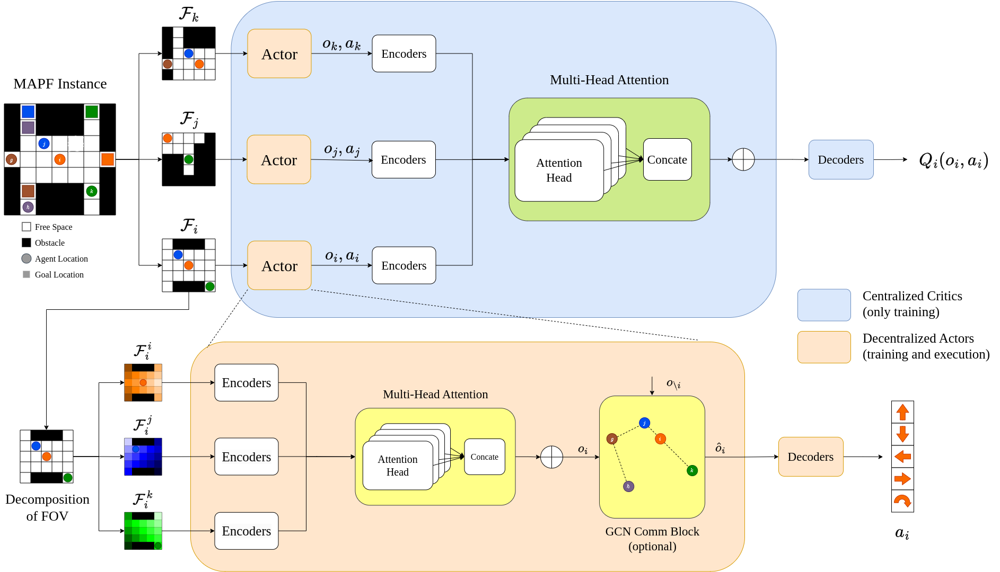

# SACHA

The code implementation for SACHA: Soft Actor-Critic with Heuristic-Based Attention for Partially Observable Multi-Agent Path Finding.



## Setup
**Dependencies**
Create the virtual environment and install the required packages.
```
conda create -n sacha python=3.10
conda activate sacha
pip install -r requirements.txt
```

**Benchmarks**
Generate the test set used for evaluation.
```
cd benchmarks
python create_test.py
```

## Code structure
| File | Content |
|---|---|
| `environment.py` | partially observable MAPF environment, heuristic maps (Sec. IV-A), shaped reward (Eq. 1) |
| `utils.py` | BFS heuristic maps, construction of the K feature maps of every agent (DHC's 6 observation channels + SACHA's heuristic and out-of-map channels) |
| `model.py` | actor with heuristic-based attention, agent-centered critic, GCN communication block (Fig. 2, Eq. 2) |
| `learner.py` | multi-agent soft actor-critic with the counterfactual baseline (Eq. 3-6) |
| `buffer.py` | episode replay buffer and curriculum |
| `worker.py` | experience collection |

## Train
  ``python train.py``  (SACHA, distributed with ray)

  ``python train.py --use_comm``  (SACHA(C))

  ``python train.py --single``  (single process, for debugging)

Checkpoints are written to `./models`.

## Evaluate
  ``python evaluate.py --load_from_dir path/to/checkpoint.pth``

# Contact
If you have any questions or issues, please contact me through this email, qiushi_lin@sfu.ca.
